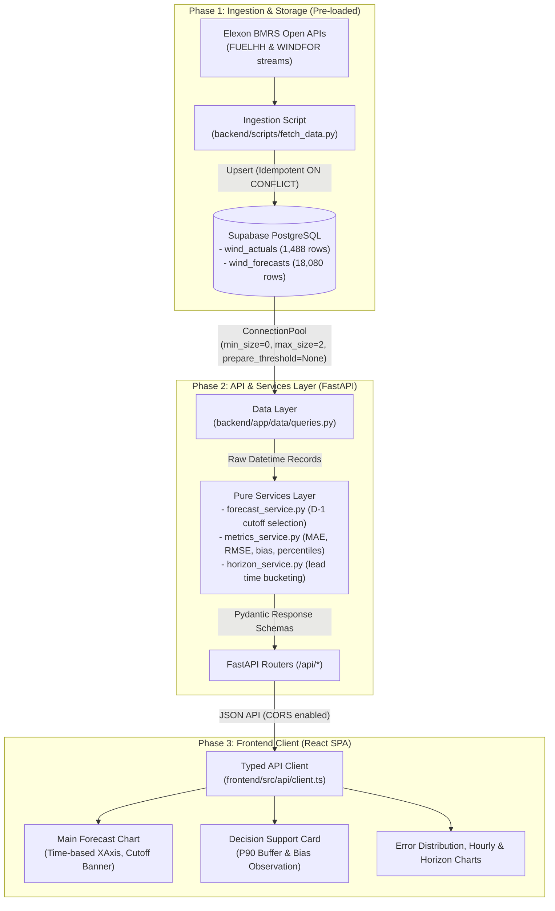

# Architecture & Technical Design Document

This document outlines the architecture, data pipeline, and key engineering decisions for the **GB Wind Power Forecast Monitoring System**. It is designed as a technical reference and presentation guide for technical leadership.

---

## 1. System Architecture & High-Level Data Flow

The application follows an asynchronous, two-tier decoupled architecture:
1. **Offline Ingestion & Storage Tier:** Ingests raw half-hourly outturn generation (`FUELHH`) and hourly day-ahead forecast revisions (`WINDFOR`) from Elexon BMRS into Supabase PostgreSQL.
2. **Online Query & Decision Tier:** A stateless FastAPI backend reads pre-aggregated, indexed data from PostgreSQL and computes forecast accuracy metrics; a Vite React SPA visualizes delivery day profiles, error distributions, and decision-support guidance.



---

## 2. Architectural Decision Records (ADRs)

### ADR-1: Pre-loaded Database vs Runtime Elexon API Calls
* **Decision:** Ingest all January 2026 data into Supabase PostgreSQL ahead of time; the runtime application **never** calls Elexon BMRS.
* **Rationale:**
  1. *Reliability & Latency:* BMRS endpoints enforce rate limits, experience scheduled maintenance windows, and exhibit 1–4 second response latency. Serving queries from indexed PostgreSQL tables delivers `<25ms` response times.
  2. *Historical Determinism:* Benchmarking trading algorithms requires frozen, reproducible data. Live queries risk upstream data restatements or revisions altering past metrics.
  3. *Cost & Scalability:* Decoupling external I/O ensures the web dashboard can scale to arbitrary concurrency without exhausting external API quotas.

### ADR-2: Resolution Mismatch Resolution (Exact Timestamp Matching)
* **Context:** `FUELHH` publishes actual generation at 30-minute intervals (:00 and :30). `WINDFOR` publishes day-ahead wind forecasts strictly at hourly intervals (:00).
* **Decision:**
  - Accuracy metrics (MAE, RMSE, Bias, MAPE, P90) are evaluated **strictly at hourly timestamps (`:00`)** where an exact counterpart exists.
  - In `GET /api/forecast`, all 48 half-hour slots are returned for completeness; `:30` slots are explicitly tagged with `status: "not_applicable"` and `forecast_mw: null`.
  - Half-hour slots do **not** count towards missing slot counts or coverage ratios.
* **Why Not Interpolation?** Linear or spline interpolation between hourly forecasts introduces synthetic data that was never produced by National Grid or available to trading desks, distorting volumetric error metrics.

### ADR-3: Segregation of Post-Target Forecast Revisions
* **Context:** Elexon's `WINDFOR` stream continues to publish forecast updates after target generation intervals have already begun (lead time $< 0$).
* **Decision:** In horizon analysis (`GET /api/horizon-analysis`), forecasts where `publish_time > start_time` are segregated into a dedicated `"published_after_target"` bucket and excluded from forward-looking lead time buckets (`<12h` through `>48h`).
* **Rationale:** Including post-delivery forecasts in forward evaluation causes look-ahead contamination, giving an unrealistic assessment of day-ahead forecast skill.

### ADR-4: Stateless Pure Services Layer
* **Decision:** All mathematical calculations, timezone conversions, and metric evaluations are implemented as pure Python functions in `backend/app/services/` that take standard primitives and return typed dataclasses/schemas.
* **Rationale:** Ensures 100% testability without database mocks, guarantees zero I/O side effects, and keeps database queries purely focused on data retrieval.

### ADR-5: Serverless-Resilient Database Connection Pooling
* **Decision:**
  - Configured `psycopg_pool.ConnectionPool` with `min_size=0, max_size=2, timeout=10.0, prepare_threshold=None`.
  - Lazy pool initialization upon first query checkout, avoiding startup deadlocks during cold starts.
  - Fully compatible with Supabase's transaction pooler (PgBouncer, port 6543) and session pooler (port 5432).
* **Rationale:** Serverless platforms (such as Vercel) dynamically freeze and spin up instances. Holding idle persistent connections (`min_size > 0`) exhausts PostgreSQL connection pools; prepared statements fail under transaction poolers. Setting `min_size=0` and `prepare_threshold=None` guarantees zero connection leaks.

---

## 3. Database Schema & Indexing Strategy

```sql
-- Actual Generation Outturn (FUELHH)
CREATE TABLE wind_actuals (
    id BIGSERIAL PRIMARY KEY,
    start_time TIMESTAMPTZ NOT NULL,
    settlement_date DATE NOT NULL,
    settlement_period SMALLINT NOT NULL CHECK (settlement_period BETWEEN 1 AND 50),
    actual_generation_mw NUMERIC(10, 2) NOT NULL CHECK (actual_generation_mw >= 0),
    created_at TIMESTAMPTZ NOT NULL DEFAULT NOW(),
    updated_at TIMESTAMPTZ NOT NULL DEFAULT NOW(),
    CONSTRAINT uq_wind_actuals_start_time UNIQUE (start_time)
);

-- Day-Ahead Forecast Revisions (WINDFOR)
CREATE TABLE wind_forecasts (
    id BIGSERIAL PRIMARY KEY,
    start_time TIMESTAMPTZ NOT NULL,
    publish_time TIMESTAMPTZ NOT NULL,
    forecast_generation_mw NUMERIC(10, 2) NOT NULL CHECK (forecast_generation_mw >= 0),
    created_at TIMESTAMPTZ NOT NULL DEFAULT NOW(),
    updated_at TIMESTAMPTZ NOT NULL DEFAULT NOW(),
    CONSTRAINT uq_wind_forecasts_start_publish UNIQUE (start_time, publish_time)
);

-- High-performance composite index for D-1 cutoff queries:
CREATE INDEX idx_wind_forecasts_cutoff ON wind_forecasts (start_time, publish_time DESC);
```

---

## 4. Video Presentation Talking Points for Tech Lead

When walking through the architecture in the technical presentation:
1. **The Energy Trading Problem:** Highlight why a day-ahead wind buyer cannot simply look at a single forecast—National Grid revises forecasts continuously. A buyer must freeze their view at **12:00 London on Day D-1** (gate closure) and quantify the volumetric risk.
2. **The 3-Tier Pipeline:** Show the Mermaid diagram demonstrating how ingestion pre-populates Supabase, how FastAPI serves pure statistical metrics, and how the React SPA renders interactive curves without business logic.
3. **The +1,806 MW Bias Story:** Point out that forecasts systematically over-predicted wind generation on **29 of 31 days (93.5%)** and in **78.9% of hours**. Explain why this means unhedged buyers face cash-out imbalance penalties.
4. **The P90 Buffer Metric:** Explain that 90% of hourly errors fell within **4,000 MW**, giving procurement managers an objective operational buffer.
5. **Production Hardening:** Highlight the `min_size=0` connection pooling for serverless cold-start resilience, multi-stage Docker builds, code-split frontend bundles, and 94% automated test coverage.
